# Carpan roadmap

Updated 13 October 2026. This roadmap builds on the existing Finance reports and records the intended next steps; it does not promise delivery dates, funding amounts or completed integrations.

## Active Sprint 2 work — 24 October 2026

The implementation deployed on 25 October 2026 adds Blockscout payment enrichment, explicit multichain USDC research and Terminal payment relationship analysis. Four selected mainnets are research-enabled; private business approval/export remains Arc-only. Real private Finance acceptance and 390px research layout checks passed. A new focused recording and Sprint 2 submission remain. See [Sprint 2 evidence and remaining work](docs/blockscout-sprint2.md). Do not treat this development status as a released integration or customer traction.

## Product direction

Carpan Finance is independent onchain payment-data infrastructure. It connects a company's wallets to verified chain movements, adds private business context and produces reviewable records. Arc Mainnet is the first chain adapter. As USDC business adoption grows, the intended commercial customer is a company or accounting-software vendor consuming Carpan's reviewed records through an API.

The Finance workflow is wallet movement → verified evidence → counterparty context → operator review → immutable output → accounting API integration. Çarpan Muhasebe Asistanı, the Turkish accounting product linked from the homepage, is a separate product.

```mermaid
flowchart LR
  Chain[Arc USDC movements] --> Evidence[Receipt and canonical evidence]
  Evidence --> Context[Private company and counterparty context]
  Context --> Review[Operator review and approval]
  Review --> Output[Immutable versioned output]
  Output -. Planned controlled API .-> Adapter[Accounting-software adapter]
  Adapter -. Planned pilot .-> Posting[Receiver accounting record]
```

A transfer proves asset movement. Its business purpose requires review. A file, webhook delivery or receiver acknowledgement is not independently verified accounting or tax posting.

## Delivered MVP baseline

- Private business workspaces and eligible wallets, account/membership isolation and private counterparties/reference codes.
- Canonical Arc USDC movement records, exact quantities, native/ERC-20 evidence deduplication and separately recorded network fees.
- Bounded latest/older reads, known-transaction imports and cumulative saved evidence with explicit partial-history coverage.
- Classification/reference, review and versioned approval, immutable decision history and output batches.
- Historical owner-signed collection pilot: request → direct user-approved transfer → receipt → recipient matching → CSV and in-app alarm.
- Arc Terminal evidence/flow/watch/alerts and reviewed Ecosystem project/market/source research, with visible provider/coverage limits.
- Connector credential/scoping, signed delivery and exact-version acknowledgement foundations implemented and tested. **Access is intentionally closed** through the separate API category, and the delivery worker is disabled. No commercial API or accounting-software posting pilot is offered today.

[Current readiness](docs/grant-readiness-2026-10-13.md) · [Finance operations](docs/carpan-finance-operations-2026-10-12.md) · [History repair](docs/carpan-finance-history-api-budget-2026-10-12.md) · [Connector implementation](docs/carpan-finance-integrations-2026-10-12.md) · [API closure](docs/carpan-api-closed-2026-10-12.md).

## Next phases and acceptance evidence

| Phase | Deliverable | Completion evidence |
| --- | --- | --- |
| 1. Reliable Arc ingestion | Durable backfill/checkpoints, bounded retry, gap detection and consistent receipt evidence; clearer operator coverage | Reproducible scans of chosen block ranges, demonstrated missing-range recovery and duplicate-free movement/fee comparisons against chain receipts |
| 2. Business workflow pilot | Work with a consenting company or team on real reviewed USDC movement records; improve counterparty mapping/rules and team access | Genuine participant feedback, permitted test records, account/role isolation and traceable decisions; owner self-tests reported separately from customer adoption |
| 3. Accounting adapter pilot | Choose one real accounting-software target; agree on schema, record identity, reversal/version handling and business mapping | Selected target's actual sandbox/end-to-end pilot, idempotent import and recoverable rejection/retry with exact record/decision versions; no posting claim before this evidence exists |
| 4. Controlled API launch | Owner-approved opening of the existing API foundation after pilot/operations gates; scoped credentials, signed delivery and explicit acknowledgement | Real hosted verification, tenant-isolation/security review, documented API contract/receiver behavior and operational recovery drill; delivery and posting states remain distinct |
| 5. Commercial rollout and expansion | Usage plans/pricing/billing and customer quotas; additional-chain movement adapters after Arc validation | Actual billing/usage measurements, agreed commercial terms and per-chain receipt/precision/dedup tests; pricing and network support announced only after validation |

Independent offsite backups/restores, external outage alerts and first-load SDK performance work support these phases. New bridge-route financial pilots remain deferred until the owner resumes them; bridge route configuration is separate from an accounting-data chain adapter.

Terminal and Ecosystem should support the Finance journey by linking each reviewed movement, address and project back to evidence. Further polish and source depth follow actual usage feedback. No new product category is needed for the initial application.

## Funding proposal boundaries

The initial Arc Microgrants submission can use the working Mainnet MVP and historical acceptance evidence. A larger Circle Developer Grants proposal should map the selected phases to actual team ownership, requested budget, delivery dates and measurable acceptance. Those figures and any customer/partner claims require real owner inputs; the roadmap supplies no invented values.

No open-source licence is granted for this repository. Third-party components and assets retain their respective rights.
