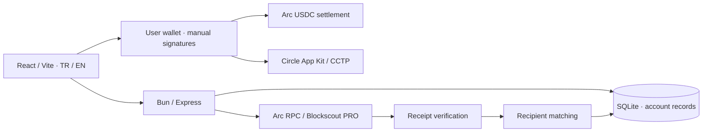

# Carpan architecture

Current product scope: 13 October 2026. [Readiness and dated evidence](grant-readiness-2026-10-13.md).

Browser wallets retain keys. API sessions, records and proposal review are account-scoped. Finance business data are additionally company-workspace scoped. The chain proves asset movement, not invoice purpose or institutional ownership. Explorer availability, cached evidence and bounded coverage remain visible. The Turkish desktop accounting product Çarpan Muhasebe Asistanı is separate from this web platform.

`arc_collection_requests` stores private details/share capabilities. `/pay/:token` exposes only reference, recipient, amount, asset and network. Checkout checks current request/wallet/funds/gas, signs one ERC-20 transfer and preserves pending/unknown outcomes. It does not automatically mark a private invoice paid. The owner refreshes an inbox or enters the hash, reviews matching and exports CSV/audit.

Native/system and ERC-20 USDC events can mirror one transfer. Finance keeps exact 18-decimal canonical system quantities and preserves 6-decimal ERC-20 aliases without counting a payment twice; checkout verifies its ERC-20 receipt. Gas is separate and counted once per transaction.

Auth uses one-use signed challenges, HttpOnly sessions, Origin/rate controls and expiry cleanup. EOA authentication only. EVM bridge checkpoints sync to a verified account; Solana history is local/exported. Neither is settlement truth.

Limits include a Collections inbox of 1,024 blocks / 20 receipts, incomplete factory/internal deployment indexing, source-dependent optional modules and no portfolio PnL. Same-server backup/restore rehearsal/monitoring exist; offsite backup and external alert delivery are unconfigured. Automated tests are not user-signed financial pilots. Historical Arc↔Arbitrum financial acceptance does not establish additional-route pilots.

## Ecosystem discovery

`GET /ecosystem` serves the dated source catalogue plus approved community entries from the active real/demo realm. The catalogue is a reviewed source snapshot, not a background scraper. Listed participants do not acquire mainnet or market status from directory membership. Reviewed contract addresses link to Terminal; the reverse address lookup includes curated source references. Existing `saved_projects` rows persist each user’s stable catalogue IDs; authenticated reads are private/no-store. No fake submitter or admin profile is inserted. Optional referral review and financial records retain their existing paths.

`GET /ecosystem/markets` and validated pool/detail/chart routes query only the fixed Arc GeckoTerminal public origin. The additive `ecosystem_market_cache` table stores public snapshots; shared request coalescing,60/120/300second TTLs,15minute stale retention,60second error cooldown and8calls/minute protect the prototype provider budget. Visible market pages refresh60seconds. Exact network/pool/token relationships are validated; nativeUSDC is normalized to the single canonical asset and64hex pool IDs are not EVM addresses. OHLCV contains source candles only. Demo realms cannot query the real provider. [Market implementation and source conditions](carpan-markets-2026-10-10.md).

`GET /ecosystem/updates` serves editor-reviewed official-source events. Exact deadlines, calendar-day programmes and announced weeks retain different precision. Expired windows leave Upcoming by default; Archive can show them. Funding and development profiles have their own review dates and sources. Neither company financing nor a roadmap implies an Arc deployment. No external news ingestion, application submission or future token price is performed.

The additive `ecosystem_update_versions`, `ecosystem_subscriptions` and `ecosystem_notifications` tables preserve reviewed revisions, explicit preferences and private inbox history. A saved project alone does not subscribe its user. Source-content fingerprints exclude a review-date-only change. API startup and a60second local worker reconcile new reviewed revisions and one24hour reminder per exact deadline for opted-in saved-project users. Old source history is not backfilled at opt-in; un-save clears preferences and stops future delivery. User IDs come from existing verified sessions, mutation origin checks apply, private routes are no-store, and demo realms cannot read real notifications. No email/push transport or network news crawler is added.

## Finance business operations

Authenticated `/api/finance/operations` services back the company console: persistent workspace membership with owner/admin/reviewer/viewer authorization, eligible business wallets, private counterparties, cumulative canonical Arc USDC evidence, decisions with optimistic versions, review/approval and immutable/idempotent export batches. Workspace creation is explicit. A verified wallet or the user's existing collection recipient can be registered; recipient authority is not claimed as cryptographic ownership. Company decisions never inherit another company's records or personal Wallet research notes.

Manual system-log scans are capped at 1,024 blocks, 20 transactions, 100 movements, 5,000 provider logs and a 30-second deadline. Historical discovery combines local index hints, private collection proofs and a budget-controlled Explorer page, then rechecks each receipt and canonical block through Arc RPC. Explicit hash imports and earlier windows retain partial coverage and retryable failures; no continuous ingestion or complete-history checkpoint is claimed. Wallet research can use a snapshot no older than 24 hours when the Explorer reserve prevents a fresh read, with its actual acquisition time and stale label. Alert freshness rules remain separate. See [operational scope](carpan-finance-operations-2026-10-12.md) and [history/credit repair](carpan-finance-history-api-budget-2026-10-12.md).

A generated `carpan.finance.operations.v1` file preserves exact quantities, reviewed decision versions and one fee record per selected transaction. It stays frozen as `readyForPosting:false` and `accountingStatus:not_submitted`; file generation and operator approval do not establish an ERP entry.

## Integration API — access closed

The separate `/developers` category states that access is closed. Finance offers only business operations and wallet research; the earlier `?view=integrations` route redirects to that category. `CARPAN_FINANCE_API_ENABLED` defaults false. Before authorization or service handlers, a gate returns `503 api_not_open` for all `/api/finance/integrations` and `/api/v1/finance` methods, including existing credentials. The main process does not start the webhook worker while closed. Internal Finance operations, authentication and the application's consumed Arc/Blockscout APIs remain available. Existing connector records and secrets are retained; opening requires the owner's explicit launch decision and interface/configuration revision. [Current closure contract](carpan-api-closed-2026-10-12.md).

The retained connector foundation includes hashed/scoped/expiring/revocable credentials, paged stored evidence and immutable outputs, exact-version append-only receiver acknowledgements and a signed webhook outbox with encrypted endpoint secrets, validated/pinned public DNS destinations and bounded retry leases. These are implementation capabilities for a later approved launch. A 2xx delivery is separate from accounting acknowledgement; even an acknowledgement is the receiver's assertion, not an independent ERP audit. Matched private encryption-master sidecars are required for relevant database backups and validated during restore. The earlier [connector specification and release acceptance](carpan-finance-integrations-2026-10-12.md) is historical where it describes an active console or API.

Usage plans/billing, continuous indexing/backfill, additional-chain data adapters, member invitations, offsite recovery and actual accounting-software pilots remain planned. No commercial ERP integration is complete. The included [roadmap](../ROADMAP.md) describes the progression from the current foundation to durable history/review pilots, an adapter pilot and controlled API launch, then commercial and additional-chain work; it does not establish committed dates, budgets or partners.
