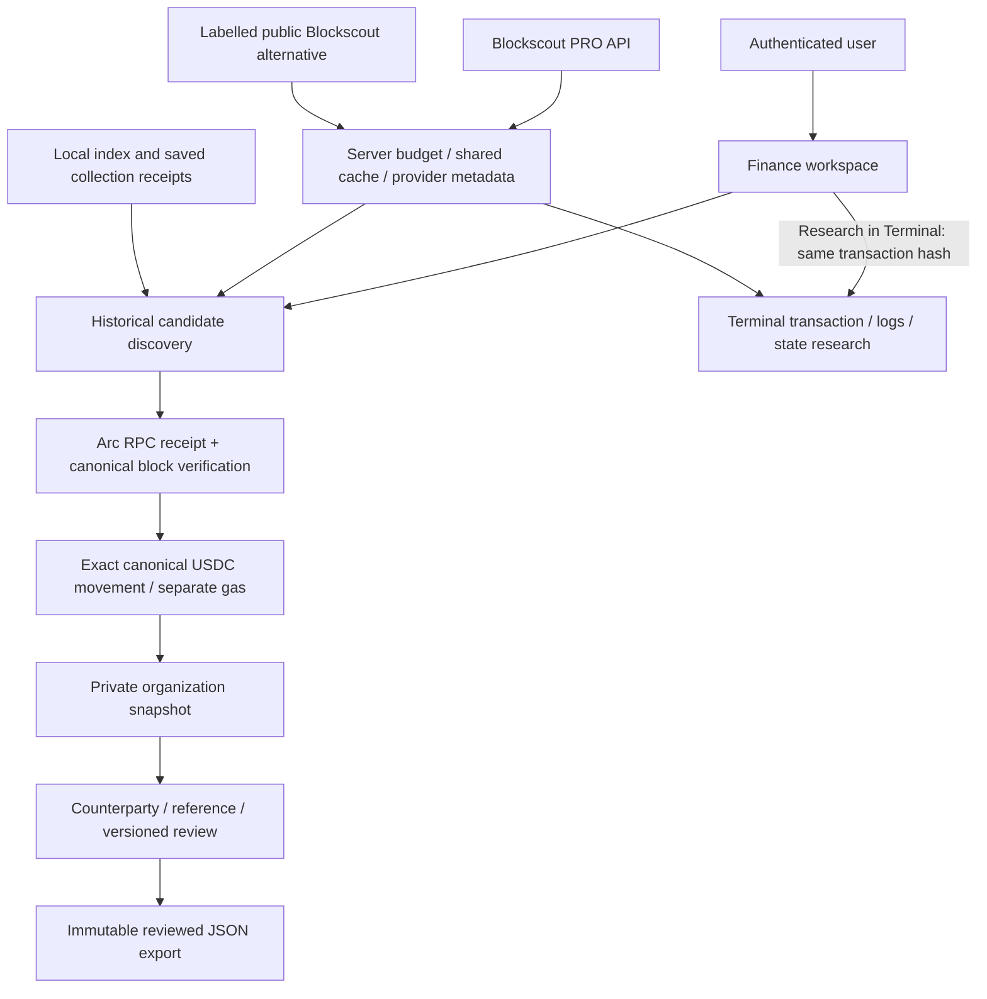

# Carpan — USDC Payment Reconciliation & Evidence

Submitted 13 October 2026 to Sprint 1 of the Blockscout PRO API Buildathon. [Live application](https://carpan.app) · [Public source](https://github.com/sgktas/carpan-app) · [4:42 narrated walkthrough](https://carpan.app/media/carpan-blockscout-demo-20261013.mp4) · [Demo notes](blockscout-demo.md). Craftora confirms Submitted; this does not claim selection or an award.

## Product

Carpan turns Arc USDC activity into an evidence-backed business review workflow. A user discovers historical transfers, researches the transaction in Terminal, checks the canonical receipt, attaches private counterparty/reference information, reviews the movement and creates an immutable export. Receipt verification and business approval are distinct states.

Finance, Terminal and Ecosystem share the product navigation. This demonstration concentrates on Finance and Terminal. It does not claim customer adoption, full wallet-history coverage or a live accounting-software integration.

## Blockscout is a real dependency

Terminal's address, transaction, token, contract and block research is implemented in `server/chainExplorer.ts`. Blockscout powers transaction summaries, transfer pages, event logs, internal calls, state changes and execution traces. The server owns provider URLs and credentials; the browser receives sanitized results and provenance.

Finance history uses `/addresses/{wallet}/token-transfers?type=ERC-20` to discover transaction candidates. The selected wallet, asset and continuation are constrained server-side. Blockscout discovery can find receipts outside the recent RPC log window. Local index entries and saved collection receipts provide additional hints when a provider page is unavailable.

Every candidate is independently checked against an Arc RPC transaction receipt and its canonical block. Blockscout does not prove invoice purpose or address ownership. An imported amount is not copied from the explorer's displayed total.

### Endpoint roles

| Resource | Blockscout role | Separate responsibility |
| --- | --- | --- |
| `/addresses/{wallet}/token-transfers` | Historical transaction discovery and pagination | Arc RPC validates receipt, block and qualifying events |
| `/transactions/{hash}` | Terminal transaction context | Finance approval remains a private business decision |
| `/transactions/{hash}/token-transfers` | Transfer investigation | Native and ERC-20 mirrors are deduplicated by canonical normalization |
| `/transactions/{hash}/logs` | Inspect event evidence | UI preserves system event identity and aliases |
| `/transactions/{hash}/internal-transactions` | Investigate internal calls | Coverage and provider availability are explicit |
| `/transactions/{hash}/state-changes` | Investigate state differences | Not a complete accounting ledger |
| `/transactions/{hash}/raw-trace` | Execution research where available | Restricted/unavailable responses are surfaced |

Mappings: [`chainExplorer.ts`](../server/chainExplorer.ts), [`financeHistory.ts`](../server/financeHistory.ts), [`arcExplorer.ts`](../server/arcExplorer.ts). PRO base: `https://api.blockscout.com/5042/api/v2`; the public Arc explorer is an explicitly labelled alternative. A cached page keeps its original provider acquisition time. A cached or RPC-only demonstration is not evidence of a new live PRO request.

## Architecture

Business records stay organization scoped. The normalizer retains exact 18-decimal native system quantities and 6-decimal ERC-20 aliases without counting one payment twice. Gas is recorded once per transaction. Discovery metadata is outside the canonical proof digest; refreshing provenance does not silently alter approved payment evidence. Previously generated exports retain their original content and hash.

## Existing baseline and new work

Carpan existed before the buildathon. Its basic Blockscout adapter, research UI and initial budget controller are prior work.

**12 October:** substantive new work added private business Finance operations, historical receipt discovery, signed continuation, canonical revalidation, endpoint-aware credit accounting, fair background polling, shared wallet caching and public-read abuse controls. Local release archive differences and test records support this chronology. They are not independent timestamps. The public repository was first published on 13 October, so its initial snapshot does not reconstruct the earlier development history.

**13 October, current revision:** added persisted movement-level discovery provenance, original cache acquisition time, independent RPC verification time and block hash, preservation across refresh/export, and direct Finance → Terminal research navigation. New tests cover PRO/public/unknown source labels, queued-page timestamps, merged discovery hints, approval preservation, immutable exports and rejection of invalid metadata. See [`finance-discovery.ts`](../src/finance-discovery.ts), [`financeHistory.test.ts`](../server/financeHistory.test.ts) and [`financeOperationsStore.test.ts`](../server/financeOperationsStore.test.ts).

The new UI labels legacy movements whose discovery source was not recorded. It does not retrospectively assign Blockscout provenance to old records.

## Reliability and limitations

- A history request reads at most one budget-controlled explorer page and twenty canonical receipts. Continuations are signed and bound to the user, organization and selected wallet; authority is rechecked after network reads.
- Quota reservation is respected. Suitable saved pages can be reused with original timestamps; unavailable data is not silently an empty history. No public fallback is used to bypass a budget refusal.
- Source, cache state and acquisition time are shown separately from Arc RPC verification. Both first discovery and subsequent receipt verification are retained.
- History is partial. Recent scans cover a bounded block range; imported receipts do not establish complete historical coverage.
- An immutable export is a reviewed data file: `readyForPosting:false`, `accountingStatus:not_submitted`. The commercial Finance API and its delivery worker remain closed.
- The existing owner-funded payment pilot demonstrates receipt matching; it is not customer revenue or an accounting-program posting.

## Submission checklist

The public repository, application, architecture and endpoint explanation are available. The [4:42 video](https://carpan.app/media/carpan-blockscout-demo-20261013.mp4) is a narrated captured-screen walkthrough, not a continuous interaction recording. It explicitly separates an isolated synthetic Finance review/export example from a real owner-funded 0.10 USDC pilot in live Terminal and Arc Blockscout Explorer. English narration uses a synthetic voice.

The [X showcase](https://x.com/carpan_app/status/2110104469967196544) is published with the Terminal visual and both organizer tags. The solo Carpan squad is approved and the [Craftora project page](https://www.craftora.tech/project/carpan/) is published. **Sprint 1 · Build the MVP was submitted on 13 October 2026; Craftora displays Submitted · Carpan.**

Confirm Türkiye participation, acceptance of meaningful new work on an existing product, reward type and the precise deadline/timezone with the organizer. The programme page has a calendar/table date discrepancy and describes the reward as credits. Source access remains public without an open-source licence, following the owner's decision.

Official references: [Buildathon brief and FAQ](https://www.craftora.tech/sprints/blockscout-pro-api-buildathon/), [Blockscout announcement](https://www.blog.blockscout.com/news-api-discovery/), [Craftora terms](https://www.craftora.tech/legal/terms/).
